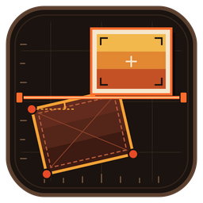
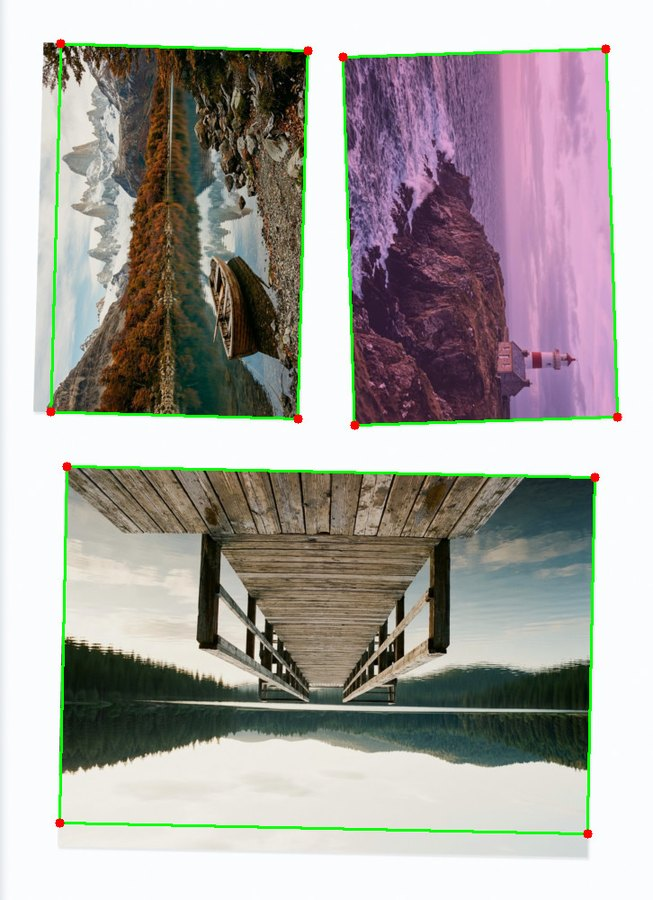
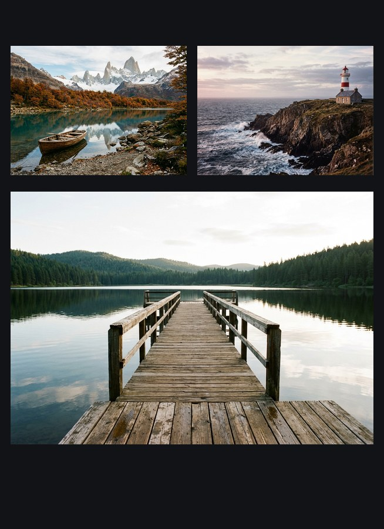

<div align="center">
  
  <h1>PhotoCut</h1>
  <p><strong>Fast, offline desktop app to automatically detect, split, deskew, orient, and restore scanned photos in full resolution — with human-in-the-loop review and non-destructive re-cropping.</strong></p>

  <p>
    
    
    
    
  </p>
</div>

---

## Why PhotoCut?

Digitizing old photo albums on a flatbed scanner usually produces huge 600 DPI sheets with 2 to 6 crooked, upside-down, or faded prints per page. Manually cropping, straightening, and color-correcting hundreds of prints takes hours.

**PhotoCut** automates the repetitive work in pure Rust — with zero external OpenCV or Python dependencies — while keeping a human in control for quick approval, color tweaks, and non-destructive re-cropping before exporting in lossless quality.

<div align="center">
  <table>
    <tr>
      <th width="50%">Input Flatbed Scan + Auto-Detection</th>
      <th width="50%">Auto-Oriented, Deskewed & Restored Output</th>
    </tr>
    <tr>
      <td align="center"></td>
      <td align="center"></td>
    </tr>
  </table>
  <sub>Sample generated with <a href="samples/demo_scan.jpg"><code>samples/demo_scan.jpg</code></a> — 3 crooked prints with mixed 90°/180°/270° rotations and vintage magenta fade, detected in 118 ms.</sub>
</div>

---

## Key Features

- **2-Stage Multi-Photo Detection & Deskew (`photocut-core`):**
  - Separable 1D local scanner-lid background modeling handles scanner edge shadow gradients and prints touching the glass margin.
  - Stage 2 Theil-Sen fine angle refinement and independent 4-side inward trimming remove paper-curl shadows and thin white scanner borders without clipping white skies, walls, or clothing.
- **100% Offline AI Auto-Orientation (`0° / 90° / 180° / 270°`):**
  - Pure-Rust ONNX inference via `tract-onnx` (no C++ runtime or DLLs to distribute) automatically rotates sideways and upside-down prints upright. Gracefully optional if the model file is omitted.
- **Vintage Dye-Fade Restoration & Non-Destructive Adjustments:**
  - Per-channel percentile auto-levels with gently capped midtone gamma balance rescues faded magenta/red analog prints while keeping modern photos natural.
  - Real-time sliders for **Auto-Color, Brightness, Contrast, Saturation, Temperature, and Tint**, plus instant **Before / After** toggle (`Space`).
- **Interactive Non-Destructive Re-Crop (`C`):**
  - Original high-resolution scans are never modified. Press `C` at any time to view the full scan sheet dimmed in gray with a crisp green frame around the active photo — drag any corner or full edge, rotate freely, zoom up to `6×`, or expand margins to recover clipped borders.
- **Unattended Multi-Job Queue ("Trabajos"):**
  - Import multiple album folders in one click, run overnight batch detection & orientation across all jobs, pause/resume anytime via atomic `.photocut.json` session files, and keep RAM flat with a bounded 3-scan LRU cache (`ScanCache`).
- **Full-Resolution Single-Pass Export:**
  - Exports directly from the original 600 DPI scan using a single Catmull-Rom bicubic warp (zero double-resampling) in configurable **Lossless PNG**, **Lossless TIFF**, or **High-Quality JPEG (80–100)**.
- **Cross-Platform Native Binary (Windows + Linux):**
  - DirectX 12 (`wgpu`) primary on Windows with automatic OpenGL (`glow`) fallback and clear error logging; native OpenGL on Linux.

---

## Quick Start

### Option 1: Portable Release (Recommended for End Users)

1. Download the latest portable archive from **[GitHub Releases](https://github.com/EnzoFernandezz11/photocut/releases)**:
   - **Windows:** `PhotoCut-vX.Y.Z-windows-x86_64.zip` → unzip and double-click `PhotoCut.exe`.
   - **Linux:** `PhotoCut-vX.Y.Z-linux-x86_64.tar.gz` → extract and run `./PhotoCut`.
2. Both portable bundles already include the local AI orientation model (`models/orientation_model_v2_0.9882.onnx`).

### Option 2: Build & Run from Source

**Prerequisites:** Rust toolchain (`rustup`, Rust 1.85+ / Edition 2024). On Ubuntu/Debian Linux, install GUI headers once:

```bash
sudo apt-get install -y pkg-config libgtk-3-dev libxcb-render0-dev libxcb-shape0-dev libxcb-xfixes0-dev libxkbcommon-dev libgl1-mesa-dev
```

Build and launch PhotoCut:

```bash
git clone https://github.com/EnzoFernandezz11/photocut.git
cd photocut
cargo build --release -p photocut-app

# Launch the Main Menu ("Trabajos")
./target/release/photocut-app

# Or jump directly into the included public sample scan
./target/release/photocut-app --input samples
```

#### Optional: Local AI Auto-Orientation Model

Download the MIT-licensed EfficientNetV2-S orientation model (`77 MB`, 98.82% validation accuracy) into `models/` next to the binary (ignored by Git):

```bash
mkdir -p models
curl -fSL https://huggingface.co/DuarteBarbosa/deep-image-orientation-detection/resolve/main/orientation_model_v2_0.9882.onnx \
  -o models/orientation_model_v2_0.9882.onnx
```

PhotoCut automatically detects `./models/orientation_model_v2_0.9882.onnx`, `<exe_dir>/models/...`, or the `PHOTOCUT_ORIENT_MODEL` environment variable. Without it, the app still runs cleanly with 1-key manual rotation (`Q` / `E`).

---

## Keyboard Shortcuts

| Key | Action |
| :--- | :--- |
| `Enter` | Approve & export photo in full resolution |
| `C` | Toggle interactive **Re-Crop** mode on the original scan |
| `Q` / `E` | Rotate 90° counter-clockwise / clockwise |
| `Space` *(hold)* | Compare **Before / After** color adjustments |
| `←` / `→` | Previous / next photo |
| `Delete` | Skip current photo |
| `F` | Fit photo / reset full-sheet zoom |

---

## Architecture

```text
photocut/
├── Cargo.toml                        # Rust workspace (single version source of truth)
├── assets/                           # Custom app icon (SVG / PNG / ICO) & README demo assets
├── samples/                          # Public sample flatbed scan for testing (demo_scan.jpg)
├── crates/
│   ├── photocut-core/                # Headless pure-Rust engine (zero GUI dependencies)
│   │   ├── src/detect.rs             # 2-stage multi-photo segmentation, Theil-Sen deskew & border trim
│   │   ├── src/orient.rs             # Pure-Rust ONNX auto-orientation (tract-onnx)
│   │   ├── src/enhance.rs            # Vintage dye-fade auto-levels & non-destructive color LUT
│   │   ├── src/export.rs             # Single-pass Catmull-Rom bicubic warp + PNG/TIFF/JPEG export
│   │   ├── src/cache.rs              # Bounded LRU scan cache (strict RAM cap)
│   │   ├── src/session.rs            # Atomic .photocut.json session persistence
│   │   └── src/jobs.rs               # Multi-job registry & subfolder album discovery
│   └── photocut-app/                 # Cross-platform desktop GUI (eframe / egui)
│       ├── src/app.rs                # Main Menu ("Trabajos") & Darkroom Review workspace
│       ├── src/crop_editor.rs        # Green interactive corner/edge/rotation overlay with zoom & pan
│       ├── src/worker.rs             # Non-blocking background worker & unattended batch queue
│       └── src/icons.rs              # Custom geometric vector icon set
└── .github/workflows/ci.yml          # Automated Windows + Linux CI & portable Release packaging
```

---

## Benchmarks & Verification

Verified against a real archive of **41 flatbed scans (`5100 × 7019 px`, 600 DPI, 150 photos total)**:

| Metric | Result |
| :--- | :--- |
| Detection accuracy | **150 / 150 photos**, **0 anomalies** (`~220–470 ms` per 36 MP scan) |
| White-border elimination (Stage 2) | **`26/150 → 0/150`** photos with ≥70% outer white rim (`8.40% → 1.06%` mean rim) |
| Local AI auto-orientation | **150 / 150** oriented (`92.34%` avg confidence, `~490 ms/photo` on CPU) |
| Memory stability (`VmRSS`) | **`+0.4 MB`** drift across 36 full 36 MP scans (`538.1 → 538.5 MB`), **`+0.0 MB`** across 150 slider cycles |
| Automated tests | **38 / 38 passing** (unit, crop invariants, worker flood/anti-hang, multi-job queue) |

Run the test suite locally:

```bash
cargo test --all-targets
```

---

## License

Released under the [MIT License](LICENSE).
